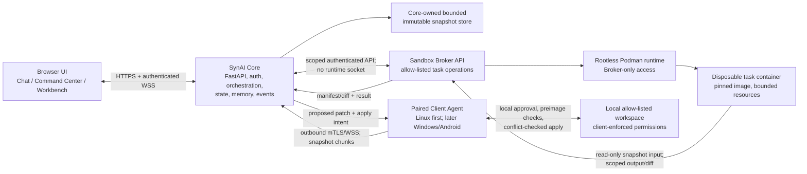

# SynAI 2.0 — Phase 13 Architecture Realignment
## Problem and proposed approach
Realign the approved web migration into a self-hosted, distributed coding system. SynAI Core remains the control plane and owns application state, but gains no general-purpose host execution or workspace-mutation authority. A separately privileged Sandbox Broker owns only disposable task containers; separately enrolled Client Agents own access to paired-device workspaces and enforce local mutation consent.
This document is the requested architecture and implementation plan. It is planning-only: no repository files, configuration, dependencies, or functionality are changed here. The architecture distinguishes current repository behavior from proposed behavior. Phase 13A's standalone plan was not found in the checkout; Phase 13B describes a read-only web foundation. The current dirty worktree includes modifications to `README.md`, `docs/phase-13b-web.md`, `synai/coding_agent/memory.py`, and `tests/test_coding_agent_memory.py`, plus untracked `web/node_modules` entries. None are changed or presumed to be authored by this task.
## Existing functionality: retain, adapt, replace
| Area | Present in repository | Disposition |
|---|---|---|
| FastAPI, auth, registry | `synai/web/app.py`, `auth.py`, `projects.py`, `workspaces.py`; authenticated read-only API, server-side sessions, CSRF/origin checks, opaque project IDs, path-validated local workspace registration | Retain auth foundations and project API patterns. Replace server-host path registration as the distributed project source of truth with logical project/device/workspace bindings. Add task/device/broker APIs without exposing Core file or execution routes. |
| Ownership and fencing | `synai/web/ownership.py` uses `flock` for legacy data-root ownership; `WorkspaceCoordinator` has leases/generations/fencing but no current writer consumes them | Retain the TUI/data-root exclusion for legacy shared data. Adapt fencing into persisted task/snapshot leases and require verification at each write/dispatch boundary. Do not use host canonical paths as web authorization. |
| Chat and coding agents | `synai/agent.py` streams chat and gates tools; `synai/coding_agent/runtime.py` includes planning, context, bounded task loops, verification, repair, routing, checkpoints, policies and memory; neither is exposed as a web task runner | Retain the orchestration and safety logic through a web adapter. Keep Chat distinct from Agent Task. Runtime file operations must target immutable Core-managed snapshots for reads and broker-owned task workspaces for writes/execution, never arbitrary host workspaces. |
| Tools and approvals | `synai/tools.py` validates arguments and policy, previews/preimage-checks mutations, invokes approvals, and gates write, terminal, Git, checkpoint and budget operations | Retain schemas, plan scope, approval callbacks and policy gates. Adapt each operation into a task-scoped broker or client capability; require fresh authority and target binding at dispatch. No implicit approval from browser authentication or autonomy policy. |
| Execution | `ExecutionBackend` protocol; `Sandbox` has restricted container settings but bridge networking; `HostExecution` is Linux-only and explicitly not isolated | Retain interface concepts and legacy TUI support. Replace web execution path with Broker API. Host execution is unavailable in Dockerized web deployment. Do not describe current Sandbox as network-isolated. |
| Index/context/change/checkpoint | `synai/intelligence/index.py`, `synai/coding_agent/context.py`, `changes.py`, `checkpoints.py` provide bounded index/context and change/recovery safeguards | Retain algorithms and safety semantics; adapt readers to immutable snapshots and checkpoint inputs to manifests/patches. No checkpoint may authorize replay of an uncertain operation. |
| Policies/routing/memory | `policies.py`, `routing.py`, `memory.py` include autonomy, validated routing and project-memory provenance/freshness/retention rules | Retain validation and provenance. Bind policy decisions to snapshot, task, model/provider and target identities. Add explicit backed-up legacy memory association; do not silently rewrite project keys. |
| UI and OpenAPI | React/Vite shell, auth, command-center/workbench routes, read-only notices and generated API types exist under `web/`; API schema is `web/src/api/schema.d.ts` | Retain shell/auth/accessibility patterns; evolve into the specified Command Center, Chat, Workbench, Devices and Sandboxes. Regenerate/check OpenAPI types for every API contract change. |
| TUI and legacy state | TUI remains the operational local interface; it shares an ownership lock for the application data root with web service | Keep operational and tested. Preserve legacy state ownership, history and formats. New Docker deployment must not expose host execution or arbitrary project mounts. |
The reviewed docs and implementation agree on the current web service being read-only; no direct contradiction was identified. The principal integration gap is that future-writer fencing exists but is not yet mandatory for writers. A further policy distinction is required: the legacy sandbox currently permits bridge networking, whereas the proposed broker's default task network is disabled.
## Revised architecture
### Component diagram

### Trust-boundary matrix
| Principal/component | May access | Must not access / enforce |
|---|---|---|
| Browser | Authenticated Core API/events; project/task metadata; previews and proposed diffs | No direct workspace access, broker/runtime socket, or authority to declare local approval. Treat all browser input as untrusted. |
| SynAI Core | Its database/configured app state; bounded, explicitly managed immutable temporary snapshots; model provider endpoints; scoped Broker API; authenticated clients | No arbitrary host workspace mount, host execution, raw Docker/Podman socket, or unrestricted container administration. No server-side client filesystem mutation. |
| Sandbox Broker | Its private runtime endpoint; only containers created and registered as SynAI-owned tasks; broker-owned staging/snapshot data | No general host shell, arbitrary container discovery/control, caller-selected host paths, or raw runtime API exposed to Core. Reject unknown ownership labels/IDs. |
| Task container | Snapshot input and isolated writable task copy/output; allow-listed tools; capped CPU, memory, PIDs, storage and duration | No host root, privileged mode, device access, unrestricted host mounts, credentials, or network by default. |
| Client Agent | Explicitly paired identity; user-configured workspace allowlist; local snapshot/patch operation | No inbound listener or unrestricted remote shell. Agent itself enforces canonical path containment, local consent, patch preimages and conflict handling. |
| User | Explicitly pairs devices, chooses source and target, reviews diffs and approves local apply | No inferred consent from a task, model output, autonomy setting, connected status or prior approval. |
### SynAI Core
Core owns FastAPI authentication/session security, Ollama/model routing, Chat and Agent Task orchestration, task state, project/device/binding registry, approvals, memory, WebSocket event delivery, and its database. Core may store bounded temporary snapshots only in a dedicated application-owned location with quotas, strict permissions, lifecycle cleanup, and explicit per-task ownership. It never mounts client projects or host workspace directories.
Core should not speak to a raw runtime socket. Its Broker client uses a narrowly scoped API and short-lived task claims bound to task ID, snapshot digest, image policy, resource profile, expiry, and fencing generation. The Broker verifies each claim independently; Core-side checks alone are insufficient.
### Sandbox Broker and initial runtime
**Initial supported runtime: rootless Podman**, operated only by a dedicated unprivileged broker identity. Rootless Podman is preferred to a privileged Docker daemon because it has a daemonless execution model and user-namespace isolation suitable for disposable task containers. The Broker, not Core, owns the rootless Podman service/socket and mediates an allow-list of create/inspect/exec/collect/remove operations. The socket is private to the broker identity and is never mounted, forwarded or exposed to Core. Podman is not a complete security boundary; use kernel hardening, deployment isolation and explicit limits.
Broker invariants:
* Allocate opaque broker-generated container IDs and persist a mapping to task, snapshot digest, owner, creation time and lifecycle state. Before inspect/exec/collect/remove, validate the ID against the registry and require matching broker-generated ownership labels; never operate on caller-supplied container names or unlabeled runtime objects.
* Accept only signed/configured image references pinned by digest from an allow-list. No caller-controlled image, build file, entrypoint override, host path, environment-secret injection, or privileged option. Image refresh is a separate reviewed operation.
* Default to no network (`none`), no capabilities, no-new-privileges, non-root user, read-only image root, private writable task layer, seccomp/AppArmor/SELinux where available, no host PID/IPC/network, no device mounts, and no ambient credentials. Any later egress requires an explicit policy/profile and controlled proxy; it is not the default.
* Enforce CPU, memory, pids, writable storage, process count, wall-clock, output bytes and concurrent-task caps at Broker and runtime layers. Fail closed if required isolation or limits are unsupported.
* Mount only Broker-managed task data: immutable snapshot input read-only and a separate task-writable overlay/output. Never bind arbitrary paths from Core or the host. Broker result collection emits a bounded patch/manifest, not a host-workspace write.
* Reconcile runtime inventory against Broker ownership records at startup. Remove only verified stale SynAI-owned containers; quarantine mismatches and report them. Cleanup is idempotent and bounded. Retain audit state for failures; never treat an uncertain task as safely completed.
### Client Agent and pairing protocol
Linux is the first supported client. Design the client protocol around versioned platform-neutral messages and capability negotiation so Windows can implement equivalent enforcement with native filesystem primitives later; Android remains a future client/companion, not a Linux-client assumption.
Enrollment uses a user-authorized, short-lived, single-use pairing challenge displayed by Core and confirmed on the device. Both an authenticated Core administrator and an explicit device-side confirmation are required. The agent generates a device keypair locally; Core stores a public key/device identity and issues revocable device credentials bound to that key. Pairing confirms a human-visible device name and requested capabilities. Re-pair/revoke invalidates credentials and active leases. Avoid reusable shared pairing secrets and client-chosen device IDs.
Connectivity is client-initiated authenticated TLS with an outbound WebSocket initially (versioned event/control frames, heartbeat, sequence numbers, replay-resistant task claims and acknowledgements). The client opens no inbound port. Core authenticates each device independently from browser sessions; reconnect resumes only known, idempotently queryable task state. A lost connection never implies approval or authorizes replay. Expired/uncertain operations require reconciliation and fresh user action.
The Client Agent advertises bounded capabilities (OS, protocol version, snapshot limits, patch formats, optional verification features), not a general shell. It stores user-approved workspace bindings locally; the server sees opaque binding IDs and optional labels, not canonical host paths. Snapshot reads and patch application are allow-listed client operations. Local approval is explicit and scoped to the displayed patch digest, destination binding, preimage fingerprints and expiry. The client verifies all path components and preimages itself immediately before applying; it rejects symlink traversal, special files, path escape, stale preimages and changed consent. No browser/API message can bypass this check.
On disconnect, local state is preserved; no queued patch auto-applies. Core marks device/lease availability, pauses operations requiring the device, emits a clear UI event, and permits safe task status inspection. Client reconnection reauthenticates and reconciles by task/operation IDs; never automatically repeat a non-idempotent command with uncertain outcome.
### Project, device, binding and snapshot identities
* **Project ID:** random server-generated stable UUID (e.g. UUIDv4/UUIDv7), independent of server-container canonical paths, device mount layout and rename. Browser cannot select or redefine it.
* **Device ID:** server-issued opaque ID bound to an enrolled key fingerprint; revocable. A new key requires explicit re-enrollment.
* **Workspace binding:** separate opaque client-local ID connecting one project to a user-selected directory on one device. Canonical path stays client-side. The project may have multiple bindings/devices; each snapshot records its exact source binding/device.
* **Snapshot:** immutable server-owned manifest plus content-addressed file objects. A versioned canonical manifest records normalized relative paths, file type, mode subset, byte length, content SHA-256, symlink policy, source project/device/binding, client signature/credential identity, creation time, and manifest digest. Project source provenance must be retained through task, plan, verification, patch, and application receipts. Reject absolute/traversal paths, duplicate normalized names, unsupported special files, unsafe links, invalid encodings where required, and inconsistent length/hash.
* **Fingerprint and quotas:** per-file SHA-256; snapshot digest over versioned canonical manifest; bounded file count, individual file size, total uncompressed bytes, path depth, transfer chunk size and concurrent uploads. Define defaults in Phase 13C API contracts and make them server-configured ceilings with stricter client limits; never trust client-provided sizes or hashes without recomputation. Expire abandoned uploads and temporary snapshots with observable cleanup.
* **Provenance:** record whether the content came from a client snapshot, which device/binding supplied it, the manifest and content digest, and every derived sandbox result. No silently substituting a new snapshot for an existing task.
Phase 12 memory identity must remain intact. Add an explicit association record from the legacy memory project key to the new project ID and optionally a device/binding, including association actor/time, source backup digest, and migration version. First provide a dry-run/export and verified backup; require an explicit user confirmation to associate. Do not rewrite legacy keys or merge memory records in place. Preserve provenance/freshness/conflict checks and provide a reversible disassociation/restore path.
### Execution and safety lifecycle
1. Client creates and signs a bounded immutable source snapshot; Core validates transfer, recomputes hashes, records provenance and stores it as immutable temporary input.
2. Chat is read-only to workspaces and cannot dispatch tools. Agent Task binds a plan to project, exact snapshot digest, model/routing decision, autonomy policy, allowed operations and proposed execution target.
3. Context/indexing reads the immutable manifest/content. The coding runtime's writes and commands are routed through a Broker-backed execution adapter against a Broker-owned task copy. Core does not create a working copy of a host workspace or gain host execution authority.
4. Broker validates task claim, fencing generation, snapshot/image/resource/network policy, then runs bounded operations. Existing tool approval, validated plan scope, model routing, cancellation and autonomy checks still apply before dispatch; broker enforces the execution envelope independently.
5. Verification and review run against the exact task result and required checks. Checkpoints capture immutable input/result identities and change attribution, not permission to replay. A cancelled, disconnected or ambiguous command is marked uncertain and not retried automatically.
6. Core returns a proposed diff with source snapshot digest, task/result IDs, file preimages/postimages, verification/review results and target labels. It cannot write the client's source tree.
7. User approves the exact diff locally on the Client Agent. Client independently checks policy, patch digest, binding, current preimages, path containment and conflicts immediately before apply; it records a local receipt. Conflict means reject and request a fresh snapshot/review; never force overwrite.
Extend safety invariants across boundaries by binding every request and result to versioned task, project, device, snapshot, target, lease generation and operation IDs. Use idempotency keys for safe queries/creation, short expiries and monotonic sequence/lease generations. Validate authorization at Core, Broker and Client independently. Cancellation revokes future dispatch, signals running process/container, waits for a definitive terminal state or records uncertainty. Recovery restores only reviewed checkpoints after preflight; it never auto-replays uncertain operations.
### UI specification
Use React 19 + TypeScript + Vite, Tailwind CSS + shadcn/ui, Slate Dark only. Maintain a responsive, keyboard/screen-reader-accessible layout at desktop, tablet and mobile widths. Persistent top-level navigation: **Command Center**, **Chat**, **Agent Tasks**, **Devices**, **Sandboxes**, **Settings**. Project-scoped navigation adds **Workbench**, **Activity**, **Snapshots**, **Memory**.
| Screen | Required content and behavior |
|---|---|
| Project Command Center (landing) | Project cards and status, recent tasks, device availability, last snapshot freshness, active approvals, sandbox health and errors. Empty state guides enrollment/project binding, not host path entry into Core. |
| Chat | Separate conversational mode with model/provider selection and authenticated streaming activity. Clearly label chat as non-executing; task creation is an explicit transition with plan/snapshot confirmation. |
| Developer Workbench | Project-scoped source snapshot browser, context/memory references, plan, bounded task activity, verification/review and proposed diff. No hidden terminal or direct project mutation. |
| Agent Task | Plan, progress and operation timeline; cancellation; selected execution target and policy; approvals; checks; checkpoint/recovery state. Show uncertain/disconnected states as blocking, not success. |
| Devices | Pair/revoke flow, device identity and capabilities, online/offline/last-seen, workspace binding aliases, snapshot limits, pending local approvals and client version. Never show or accept server-side canonical client paths. |
| Sandboxes | Broker readiness, allowed image digests/profiles, active task containers, quotas and cleanup/audit errors. Show no runtime socket or arbitrary container admin. |
| Snapshot and patch review | Immutable manifest/digest, Source Device, timestamp/freshness, file summary, destination, exact preimages, additions/deletions, verification and review status. Local apply requires confirmation in client agent; browser approval is not local apply approval. |
| Responsive/activity states | Authenticated WebSocket activity has reconnect/sequence indicators and bounded polling/status fallback. On device/broker loss, stale snapshot, denied approval, quota, validation, cancellation, verification failure or conflict, preserve evidence and show actionable error; never render a success-shaped fallback. |
On task headers and review surfaces, visibly separate three labeled identities at all times: **Source Device** (which supplied the snapshot), **Execution Target** (sandbox profile/device capability selected to run), and **Apply Destination** (client binding that may receive the reviewed patch). Do not imply they are the same device or destination.
### API, client and broker protocol outline
All schemas are versioned, typed, documented in FastAPI/OpenAPI and regenerated into `web/src/api/schema.d.ts`. Browser routes remain authenticated with CSRF/origin protections; WebSocket sessions authenticate and authorize each project/task subscription. Device credential auth is separate from browser auth.
**Core browser API (proposed):** device pairing/revocation and project/binding metadata; project/task list/detail/create/cancel; snapshot/task status; approvals and diff review; memory association preview/confirm/restore; health/readiness. No raw file write, shell, host-path registration or runtime administration endpoint. Uploads accept bounded chunked data with declared manifest, chunk hashes, idempotent upload IDs, server-computed content hashes, strict quotas and cleanup.
**Client protocol (proposed):** versioned outbound WebSocket messages `hello`, `capabilities`, `heartbeat`, `snapshot.begin/chunk/commit`, `task.offer/ack/status`, `approval.request/result`, `patch.offer`, `apply.request/result`, `reconcile`, and `revoke`. Every task/patch/apply message binds project/device/binding/task/snapshot/operation IDs and expiry; acknowledgments include monotonic sequence and result digests. Snapshot upload goes through Core's bounded temporary store (user-selected topology), not directly to Broker. Client applies only locally approved, exact-digest patches.
**Core–Broker API (proposed):** private mTLS or equivalent service identity, task-scoped short-lived claims, strict request/response schemas; `prepare(snapshot_digest, profile, claim)`, `start(task_id)`, `exec(task_id, operation_id, allowlisted_tool, bounded_args)`, `status(task_id)`, `collect(task_id)`, `cancel(task_id)`, `remove(task_id)`. No generic container ID or arbitrary command API. Broker computes and records output manifest/diff digests; Core checks response binding and state transition.
**Errors and compatibility:** stable machine-readable codes for auth, replay, lease/fence, unsupported protocol, quota, unsafe path, stale preimage, unavailable target, policy denial, runtime failure and uncertain result. Additive API/schema evolution with protocol negotiation; reject unknown unsafe capabilities and unsupported major versions. Audit security-relevant decisions without logging secrets or full source contents.
## Phase 13B migration impact
Phase 13B's read-only foundation is retained as the authenticated management/API shell, but its server-host workspace model is not the durable project abstraction for distributed execution. Preserve its authentication hardening, separate web metadata database, opaque ID discipline, generated OpenAPI types and legacy data-root lock semantics. Keep path canonicalization where required by legacy local/TUI registration, but do not make it the authority for new client projects.
Introduce additive, versioned tables/migrations for devices, credentials/revocation, logical projects, client-local workspace bindings, immutable snapshot manifests/objects and lifecycle, task target/lease, broker task mappings, approvals, event cursors, and legacy memory associations. Use foreign keys, uniqueness, state constraints, expiry/cleanup indexes and transactional migrations. Back up before migration; migration is additive and does not rekey memory or reinterpret existing workspace rows. Existing project IDs are mapped explicitly or remain legacy records; no path-derived identity conversion without user-confirmed association. Rollback leaves old rows/data intact and disables new routes/workers rather than deleting migrated state.
The `WorkspaceCoordinator` currently addresses host workspace leases. New task leases must fence logical snapshot/task operations and Broker claims; they should not pretend a device-local path lock is held by Core. The existing TUI and ownership lock continue to protect the legacy application data root. Migration must retain the separation between web metadata and TUI-owned legacy data.
## Phased implementation roadmap
The file paths below are exact existing touchpoints where known and proposed likely new paths otherwise; confirm naming against repository conventions before implementation. Each phase is additive and must preserve previously passing Python and frontend tests.
### Phase 13C — Distributed architecture foundation
* **Components/files:** adapt `synai/web/{app.py,auth.py,database.py,projects.py,workspaces.py,schemas.py,openapi.py}`; `web/src/api/schema.d.ts`; add `synai/web/devices.py`, `synai/web/snapshots.py`, `synai/web/tasks.py` and corresponding tests under `tests/`; document protocol/ADR under `docs/` after this plan is accepted.
* **Interfaces:** versioned device enroll/revoke, logical project/binding, snapshot begin/chunk/commit/manifest, task/lease/status and authenticated event subscription schemas. Define limits/error codes and outbound client message contract. Keep execution and patch apply disabled in this phase.
* **Storage:** additive web DB migrations for device public keys/credential revocation, logical IDs/bindings, snapshot manifests and temporary-object lifecycle, tasks/leases/event cursors, memory associations. Core-owned snapshot area gets quotas/permissions/cleanup. Do not mutate Phase 12 identities.
* **Security:** device-bound auth; single-use expiring pair tokens; server-generated IDs; recomputed hashes; path/manifest validation; sequence/replay and expiry checks; fence/generation enforcement; no host project mount or execution. Audit privacy reviewed.
* **Tests/adversarial:** schema compatibility, migration from empty and populated 13B DB, duplicate/racing pairing, revoked/replayed credentials, traversal/duplicate/symlink/special paths, false lengths/hashes, oversized/chunk-reordered snapshots, abandoned upload cleanup, stale lease/fence, unauthorized browser/device cross-use, memory-association backup/dry-run/restore.
* **Dependencies:** Phase 13B auth, DB, OpenAPI and API shell.
* **Acceptance:** old auth/project/readiness tests pass; additive migration and rollback verified; snapshot records are immutable and path-independent; limits and device revocation fail closed; no execution endpoint or runtime access exists.
* **Deferred:** desktop client, broker/runtime integration, task execution, auto memory migration, Android/Windows clients.
* **Rollback:** disable new routes and reject new protocol versions; retain DB rows and snapshot backups for recovery; no destructive down-migration.
### Phase 13D — Command Center and browser chat
* **Components/files:** evolve `web/src/App.tsx`, `web/src/auth/AuthContext.tsx`, `web/src/api/` and existing route/page/components; add Command Center, Chat, Devices/Sandboxes status shells, responsive activity and typed API client tests.
* **Interfaces:** consume 13C project/device/snapshot/task read APIs and authenticated WebSocket activity; chat-only API and model selection must not dispatch coding tools.
* **Storage:** user UI preferences only if an existing supported store is available; server persists only chat/task state under its application DB. No local project source storage in browser.
* **Security:** CSRF/origin/session handling retained; WebSocket authorization/subscription checks; output escaping; browser Chat cannot execute or approve local patch apply.
* **Tests/adversarial:** keyboard/screen reader and responsive behavior; unauthorized project subscription, expired session/reconnect, event replay/gaps, malicious streamed text, empty/error/loading states, Chat-to-task boundary, explicit three-target labels wherever relevant.
* **Dependencies:** 13C read APIs and event contract.
* **Acceptance:** Project Command Center is landing page; Slate Dark, required navigation, separate Chat/Agent Task and clear non-execution state; existing frontend tests remain passing.
* **Deferred:** final Agent Task execution UX and patch apply flow until 13F/13G.
* **Rollback:** feature-flag new routes; retain login/read-only registry shell and existing API behavior.
### Phase 13E — Desktop client companion
* **Components/files:** add a separately packaged Linux agent (proposed `client/` or `synai/client_agent/` after repository convention review), protocol models, enrollment/trust storage, workspace allowlist, snapshotter and local approval UI/CLI; add client protocol and adversarial tests. Do not put the agent's filesystem authority inside the Core container.
* **Interfaces:** implement 13C pairing, capability, heartbeat, snapshot, status and reconcile protocol over authenticated outbound TLS/WSS. Expose only fixed operations, no shell.
* **Storage:** private OS user-owned key/credential store and local binding records; local audit/apply receipts. Core gets opaque binding IDs and snapshots, not canonical workspace paths.
* **Security:** key generation/revocation; secure credential storage; no inbound port; safe traversal/symlink handling; bounded snapshot transfer; no remote write until the later patch phase and local approval is implemented.
* **Tests/adversarial:** expired/replayed pair code, revoked key, path alias/symlink escape, race while scanning, huge files/trees, disconnect/resume, server impersonation, malformed manifest/chunks, credential permissions.
* **Dependencies:** 13C protocol and device registry.
* **Acceptance:** user can pair/revoke Linux device, define local allowlist, upload immutable snapshots within limits, observe offline/reconnect state; unsupported capabilities fail safely.
* **Deferred:** Windows implementation, Android application, remote terminal, unattended apply.
* **Rollback:** revoke credentials and disable client protocol endpoint; local source files remain untouched and local credentials can be removed independently.
### Phase 13F — Sandbox execution and Agent Task integration
* **Components/files:** add isolated Broker service/API (proposed `sandbox-broker/` plus deployment-specific configuration), signed claim client in `synai/web/`, Broker-backed `ExecutionBackend` adapter, task orchestration adapter around `synai/coding_agent/runtime.py`, and dedicated tests. Update `synai/sandbox.py` only for legacy compatibility if needed; do not repurpose legacy host backend for web.
* **Interfaces:** Core-to-Broker scoped API; prepared immutable snapshot digest and approved profile; task state/operation IDs; bounded collect/cancel/status responses. Connect Agent Task UI to accepted task/status contracts.
* **Storage:** Broker-private ownership/lifecycle registry and staged snapshot/result data; Core DB task state and audit events. No shared host workspace path. Define retention/cleanup for container layers and result patches.
* **Security:** dedicated rootless Podman identity; never expose its socket to Core; allow-listed images by digest; no network default; per-container resource caps; ownership validation; short-lived fenced claims; all existing policy/tool approval/routing/review/verification/checkpoint safeguards enforced. Web runtime cannot fall back to HostExecution.
* **Tests/adversarial:** forged task/container IDs and labels, stale/replayed claims, malicious image/tool args, network probing, resource exhaustion, output flooding, container escape configuration checks, broker restart/reconciliation, cancel/disconnect during command, uncertain completion, unauthorized collect/remove, Core compromise cannot reach runtime socket.
* **Dependencies:** 13C snapshot/task claims and 13E device source; 13D Agent Task view.
* **Acceptance:** Agent Task operates only on the exact client snapshot in broker-owned disposable container; task output is immutable and reviewable; Web deployment has no host execution path; unsupported isolation/limits stop task with explicit errors.
* **Deferred:** client patch application, arbitrary images/network, multi-host broker orchestration and general terminal.
* **Rollback:** feature-flag task dispatch; stop new tasks, reconcile/clean only verified owned containers, preserve audit/results/checkpoints and resume read-only operation.
### Phase 13G — Client patch application
* **Components/files:** extend client agent with staged diff review, local approval and conflict-checked apply; Core API for signed patch offer/apply status/receipt; Workbench patch review UI; tests for client and API.
* **Interfaces:** patch references exact snapshot digest and task result; apply intent binds patch digest, destination binding, preimages, user approval and expiry; client returns applied/rejected/conflict receipt with resulting hashes.
* **Storage:** immutable patch/diff and verification artifacts; client-local approval and apply receipt; bounded retention and cleanup policies. Preserve checkpoint provenance.
* **Security:** Core cannot apply; browser confirmation is not local consent; client rechecks canonical containment, symlink safety, exact preimages and digest immediately before writes; atomic per-file strategy where supported; no force overwrite; stale snapshot forces replan.
* **Tests/adversarial:** time-of-check/time-of-use path replacement, symlink swaps, stale or forged preimages, partial apply/crash, duplicate apply request, consent expiry/revocation, patch traversal/binary/special files, disconnect before/after local commit, mismatched device/binding.
* **Dependencies:** 13E client and 13F verified patch output.
* **Acceptance:** user can review exact diff and explicitly approve on local client; only conflict-free matching files are applied; durable receipt links source snapshot, sandbox result and apply destination; no auto-apply on reconnect.
* **Deferred:** unattended policies, force apply/merge, cloud sync, Android patching until separately designed.
* **Rollback:** disable apply offers; keep diff review/read-only, never roll back local changes automatically; local recovery uses user-visible receipt and existing backups.
### Phase 13H — Production Docker deployment and hardening
* **Components/files:** production Core/Broker deployment definitions and images (proposed `deploy/` or existing deployment conventions), least-privilege volumes/networking, health/readiness, backup/restore and operational docs; CI checks and deployment tests.
* **Interfaces:** production secrets/bootstrap, Core↔Broker service identity, supported Podman host contract, health and audit endpoints; pin protocol versions and images.
* **Storage:** separate persistent Core state, bounded temporary snapshot volume and Broker-owned runtime storage; encrypted/off-host backups for DB/legacy memory association metadata; retention and disaster recovery.
* **Security:** Core container has no host workspace mounts, privileged mode or runtime socket; Broker isolated under dedicated UID and private socket; network segmentation; secret rotation; image digest verification; resource limits; log redaction; update/rollback controls; threat model and incident procedures.
* **Tests/adversarial:** inspect rendered deployment for mounts/capabilities/sockets, non-root identities, network reachability and quotas; backup restore and migration downgrade posture; broker unavailable/restarted; disk full; certificate rotation; stale credentials; container inventory mismatch; vulnerability/image policy gates.
* **Dependencies:** 13C–13G contracts and behavior.
* **Acceptance:** reproducible production deployment enforces stated boundaries; Core compromise does not yield host execution/runtime administration; restore and rollback retain task provenance and legacy memory; full Python and frontend suites pass.
* **Deferred:** high availability, multi-node scheduling, public hosted SaaS, Kubernetes, general remote shell, automatic migration of legacy memory.
* **Rollback:** versioned images and additive migrations; disable task/apply feature flags first; restore verified backups where needed; never delete user memory or uncertain execution evidence.
## Architectural contradictions and unresolved decisions
1. **Core snapshot writes versus least authority:** permitted only in a dedicated bounded app-owned temporary store; no arbitrary host paths. Specify volume permissions, quotas, encryption-at-rest policy and cleanup guarantees before deployment.
2. **Legacy workspace coordination versus distributed project identity:** current leases depend on server-local workspace identity; new fencing must be logical and task/snapshot-scoped. Never claim a Core lease protects client-local files; client preimage/conflict checks are the apply authority.
3. **Existing Sandbox network behavior:** bridge networking today is not acceptable as the default for new broker tasks. No-network-by-default may constrain package installation; provide prebuilt images or a separately approved egress profile rather than silently enabling network.
4. **Broker privilege boundary:** rootless Podman reduces but does not eliminate host-kernel/runtime risk. Confirm supported Linux kernel, cgroup, seccomp and LSM assumptions and whether Broker should run on a separate host before production; lack of required enforcement means fail closed.
5. **Snapshot and task limits:** concrete numeric limits, quotas, retention and cleanup SLOs require operator/product values. Phase 13C should ship conservative defaults, configurable only within hard ceilings, and adversarial tests.
6. **Patch atomicity:** cross-platform filesystems cannot guarantee one atomic multi-file transaction. Define partial-apply receipt and recovery UX; default to per-file atomic replacement with preflight-all and no silent partial success.
7. **Windows/Android future support:** wire-neutral protocol and server-side opaque paths enable future clients; local filesystem enforcement and credential UX remain platform-specific. Android companion scope and capability set are intentionally deferred, not promised by the Linux implementation.
8. **Phase 13A plan absence:** reconcile any external approved 13A decisions before coding; Phase 13B documentation currently notes no checked-in 13A plan.
## Plan todos
1. Produce revised architecture, trust-boundary, protocol, identity, UI and migration specifications. **Done in this plan.**
2. Implement Phase 13C distributed architecture foundation.
3. Implement Phase 13D Command Center and browser chat.
4. Implement Phase 13E Linux desktop client companion.
5. Implement Phase 13F Sandbox Broker and Agent Task integration.
6. Implement Phase 13G client-side patch application.
7. Implement Phase 13H production Docker deployment and hardening.