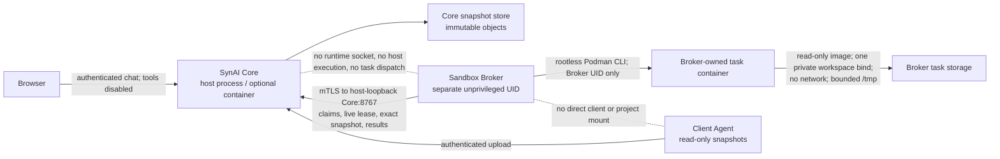

# Phase 13F-A.2 — Broker Host Qualification Package

**Status: NOT READY — SECURITY IMPLEMENTATION GAPS**

This package records read-only host findings and executable test evidence for
Phase 13F-A.2. It is prepared for review; it is **not** an independent
security review, production deployment approval, or runtime acceptance.
No accounts, packages, images, services, mount options, firewall rules, or
host security settings were changed for this assessment. Python dependencies
for the 3.13.5 test run were installed only into a temporary virtual
environment and are removed during cleanup.

## Trust boundary



The Core control listener and Broker listener currently bind to
`127.0.0.1` on separate ports. The Broker client also connects to
`https://127.0.0.1:<Core-control-port>`. This route is valid only when both
processes share the host network namespace. A container's loopback is not
the host's loopback. The current inspected Docker daemon has running
containers and networks for unrelated applications, but no SynAI Core or
Broker container, no SynAI listener on ports 8765–8767, and no configured
SynAI Docker deployment manifest was found. Thus there is no active
Core–Broker route to verify. If Core is later containerized, this loopback
configuration will not connect; use a private, explicitly addressed service
network and obtain an ADR review before changing the listener or route.
Do not use `host` networking or publish a Broker port publicly as a shortcut.

Core has no Podman/Docker socket or Broker runtime-administration endpoint.
Production Browser Chat remains tool-disabled; the Client Agent remains
read-only. Only the gated integration-test authorization exists; it is not
production approval.

## Host capability matrix

Observed on 2026-10-11 by read-only commands:

| Capability | Observation | Qualification |
|---|---|---|
| OS / kernel | Ubuntu Server 26.04.1 LTS; Linux `7.0.0-38-generic`, x86_64 | Host identity confirmed |
| Rootless Podman | Podman 5.7.0; `rootless=true`; graph driver `overlay`; graph root `/home/luser/.local/share/containers/storage` | Runtime available; no task container executed |
| User namespace | `podman unshare` maps container UID/GID 0 to host UID/GID 1000 and 1–65536 to subordinate range 100000–165535 | Mapping observed for current `luser`, not a Broker service identity |
| Cgroups | cgroup v2; controllers include CPU, memory, PIDs and others | Controller presence is not task-level enforcement evidence |
| Seccomp | Podman reports `seccompEnabled=true`, profile `/usr/share/containers/seccomp.json`; kernel config has `CONFIG_SECCOMP=y` and `CONFIG_SECCOMP_FILTER=y` | Actual task profile behavior remains untested |
| LSM | AppArmor appears in `/sys/kernel/security/lsm` and module parameter is `Y`; Podman reports AppArmor disabled and SELinux disabled; `aa-status` could not read profile set without privilege | No effective task AppArmor/SELinux confinement demonstrated |
| Root filesystem | `/dev/mapper/ubuntu--vg-ubuntu--lv`, ext4, mounted `/` with `rw,relatime`; 914 GiB total, 614 GiB free; no `prjquota` mount option | Project quota is not active on Broker's current filesystem |
| Root filesystem inodes | About 60.9 million total, 58.2 million free | Global availability is not a per-task quota |
| `/tmp` | 16 GiB tmpfs; 1,048,576 inodes; mount shows `usrquota` | Shared, volatile global mount; not a task-scoped durable quota |
| Quota support | Kernel config reports `CONFIG_QUOTA=y`, `CONFIG_QUOTA_TREE=m`, `CONFIG_TMPFS_QUOTA=y`; XFS tools installed, but actual storage is ext4 | Kernel capability/configuration does not prove filesystem enforcement |
| Broker identity | No `synai-broker` account; current `luser` UID 1000 is in `sudo`, `docker`, and `lxd` groups | Not an acceptable Broker service identity |
| Local Podman images | `podman images --digests` returned no entries | No approved digest-pinned test image |
| Docker topology | Docker networks exist for unrelated applications; no running container name/image identified as SynAI | No Core/Broker network route available to qualify |
| Core/Broker service | No SynAI process, user service, or listener on ports 8765–8767 observed | Deployment topology and real control channel unverified |

The reported `df` values are point-in-time host-wide capacity only and do not
establish quotas. The `/tmp` `usrquota` mount option is not a per-task or
project quota.

Redacted read-only command excerpts:

```text
$ podman --version
podman version 5.7.0

$ podman info --format json  # selected fields
rootless=true
cgroupVersion=v2
seccompEnabled=true
seccompProfilePath=/usr/share/containers/seccomp.json
apparmorEnabled=false
selinuxEnabled=false
graphDriverName=overlay
graphRoot=/home/luser/.local/share/containers/storage

$ findmnt -T /home/luser/synai -o TARGET,SOURCE,FSTYPE,OPTIONS
/ /dev/mapper/ubuntu--vg-ubuntu--lv ext4 rw,relatime

$ cat /sys/fs/cgroup/cgroup.controllers
cpuset cpu io memory hugetlb pids rdma misc dmem

$ podman images --digests --no-trunc
# no local image rows

$ docker ps --format '{{.Names}} {{.Networks}}' | grep -i synai
# no SynAI containers
```

## Storage design decision

### Selected target design (not provisioned or implemented)

Use a **dedicated ext4 filesystem with project quotas**, mounted at a
Broker-only storage root using `prjquota`. Pre-provision a finite pool of
task slots, each assigned a unique project ID and a hard block and inode
limit. The Broker's private registry would allocate one slot per task; no
runtime request, Core request, or model operation would be allowed to assign
project IDs or change quota limits.

The immutable staged snapshot, task writable copy, and container bind-mounted
workspace must all be inside the same task project's quota. The dedicated
filesystem's fixed capacity supplies the aggregate hard ceiling across all
concurrent tasks; the pre-provisioned slot pool caps task count. The
per-project hard limits cap each task's allocated blocks and inodes during
writes, including writes through Broker operations and the container bind
mount. A Broker startup verifier must inspect the actual mount options,
filesystem identity, project ID inheritance, block/inode hard limits, slot
ownership, and aggregate filesystem bounds before setting `workspace_quota`
true. None of these Broker-side checks currently exists.

Container root is read-only. `/tmp` is a separate per-container tmpfs with a
64 MiB byte limit and, in current code, a 4096 inode limit. This tmpfs is
volatile and is not the persistent workspace. The code change to add the
inode limit is covered only by non-runtime tests; Podman enforcement has not
been demonstrated. Podman writable layers must remain disabled/read-only;
container logs and any future scratch mounts need explicit bounds and
inspection before acceptance.

Project quotas charge allocated filesystem blocks and inodes as writes
occur, rather than trusting directory scans. The dedicated filesystem
capacity is necessary because per-project hard limits alone do not reserve
capacity and could sum to more than the device. The implementation must
reserve room for filesystem metadata and recovery, use one project per task,
and test writes, parallel writes, rename, hard-link attempts, sparse files,
and cleanup. ext4 does not provide the XFS reflink behavior; if the chosen
filesystem or mount later enables block-sharing features, quota accounting
must be retested before use.

The snapshot plus its writable copy consume quota too. With the current
64 MiB snapshot maximum, a full snapshot can require roughly 128 MiB before
new task output or metadata. Quota values must be derived from the approved
resource profile and include that duplication, bounded generated output,
filesystem metadata, and safety margin. They must not be inferred from the
current `workspace_bytes` setting alone.

### Alternatives rejected for this host

| Option | Reason not selected |
|---|---|
| XFS project quotas | The actual target filesystem is ext4, not XFS. Changing to XFS needs an operator-provisioned separate filesystem and would not be an in-place verification of current storage. |
| Existing ext4 root with project quotas | The current `/` mount has no `prjquota`; enabling it requires privileged filesystem/mount configuration and operational review. Do not modify the live root filesystem as part of this task. |
| Existing `/tmp` tmpfs | It is shared, volatile, globally sized, and not associated with a per-task project. It cannot hold durable staging/recovery state under the required ownership model. |
| Podman writable layer / named volume | The task workspace is a host bind mount. Overlay or volume limits do not enforce arbitrary bind-mounted host storage. No local approved image or volume quota setup is available. |
| Post-operation directory scan / numeric configuration | Neither prevents concurrent writes, sparse-file abuse, inode exhaustion, crash-time growth, or writes through container processes. Not enforcement. |

Consequently, **no byte or inode quota test was run**. `workspace_quota`
must remain false. The selected mechanism requires an operator-provisioned
filesystem and a Broker slot/quota integration before it can be accepted.

## Authentication and certificate custody

The source configures mutual TLS on both optional service listeners, binds
them to loopback, uses certificate verification, and rejects cleartext.
The Broker requests exact Core snapshot and lease authority over its
authenticated HTTPS client. There is no production Core-to-Broker task
dispatch route yet.

A real loopback HTTPS listener test uses disposable CA and leaf credentials
to exercise the same Uvicorn `CERT_REQUIRED` behavior:

- trusted Core test identity succeeds;
- no client certificate, an untrusted issuer, and an expired client
  certificate fail the TLS connection;
- overlapping CA trust accepts old and new certificates during rotation;
- removing the old CA from the trust bundle rejects its certificate while
  the new certificate continues to work;
- a new request succeeds after listener restart/reconnection.

The test uses temporary material only; it does not qualify production
issuance, SAN/EKU profiles, permissions, host routing, or Core's reverse
listener. Trust is CA-based: deployment must use a dedicated, access-
controlled trust root per service identity and must not put unrelated client
certificates under the accepted service CA. Revocation is implemented by
removing the issuer/identity from the trust set and restarting/reloading the
listener; there is no online CRL/OCSP enforcement or per-leaf revocation
mechanism verified. A short-lived certificate expiry is enforced by TLS
validation. Key custody, renewal automation, and compromise procedures need
operator review.

## Claim, lease, side-effect, and recovery state

Core's persisted integration-test authorization is the claim authority.
Claims bind project/task, exact immutable snapshot and digest, operation and
argument digest, approval/policy provenance, image/resource profile,
allocation and fencing generation. The Core control service validates the
live lease and revocation state; claims are short-lived. The Broker durably
records the claim/signature and operation before dispatch, and uncertain
operations are not replayed. Snapshot grants are one-use and result
artifacts are independently checked by Core.

The automated Core authority tests cover claim signature, replay, one-use
snapshot grants, revocation, fencing and artifact verification. These are
unit-level contract tests and do not prove the live mTLS Core–Broker path.
No authorized task has run in a real container; active-command revocation,
Core disconnect, bounded process/container termination, and post-restart
reconciliation are **blocked**, not passed.

## Security acceptance matrix

| Invariant | Enforcement point | Test / evidence | Result |
|---|---|---|---|
| Broker byte quota is enforced while writing | Dedicated per-task ext4 project quota (not yet provisioned or integrated) | No quota environment; no write-past-limit test | **BLOCKED** |
| Per-task inode quota and aggregate active-task storage cap | Project inode hard limit, finite task-slot pool, dedicated FS capacity | No project quota or slot allocator | **BLOCKED** |
| Snapshot, copy, Broker writes and container writes share the quota | All paths must reside in the task's project slot | Current implementation uses ordinary host bind workspace | **FAIL / IMPLEMENTATION GAP** |
| mTLS accepts trusted client and rejects missing/untrusted/expired peer | Uvicorn TLS listener with `CERT_REQUIRED` and dedicated peer trust bundle | `tests.test_broker_mtls` using ephemeral loopback listener/certificates | **PASS (test credentials only)** |
| Certificate rotation/revocation via trust-set change | Trust bundle replacement and listener restart | `tests.test_broker_mtls`; CA overlap and old issuer removal | **PASS (test credentials only)** |
| Production certificate identity, permissions, and reverse listener | Core/Broker deployment configuration and operator PKI | No deployed identities or active Core service | **BLOCKED** |
| Core–Broker network route is private and reachable | Current code uses shared-host loopback only | No SynAI Core/Broker process/container or active route | **BLOCKED** |
| Rootless task isolation and resource limits | Rootless Podman, seccomp, LSM, cgroups, fixed image/profile | Rootless Podman probes pass; no image, Broker UID, active LSM, or runtime test | **BLOCKED** |
| Revocation / Core outage terminates actual task process | Lease monitor, runtime kill, independent inspect | No disposable task container available | **BLOCKED** |
| Restart reconciliation never replays uncertain mutation | Durable Broker registry and scoped runtime reconciliation | Unit tests only; no runtime/container restart test | **BLOCKED (runtime)** |
| Core has no runtime socket or host-execution fallback | Separate Broker package and no Core runtime API | Source/config inventory; no live deployment mount inspection | **PASS (source boundary); deployment unverified** |
| Browser Chat remains tool-disabled; Client Agent read-only | Existing web/Client Agent boundaries | Existing Python/frontend/browser regressions | **PASS (regression)** |

No skipped or mocked container test is counted as a runtime pass. The
independent review has not been performed.

## Operator provisioning and rollback procedure

All actions below are **operator-controlled and unexecuted**. First perform
them in a disposable VM. Do not use the live root filesystem or unrelated
Docker/Podman containers as a test target.

### Read-only inventory

Run as an operator and retain output:

```sh
uname -a
cat /etc/os-release
podman --version
podman info --format json
podman unshare cat /proc/self/uid_map
podman unshare cat /proc/self/gid_map
getent passwd synai-broker
grep -E '^[^:]+:' /etc/subuid /etc/subgid
findmnt -T /srv/synai-broker -o TARGET,SOURCE,FSTYPE,OPTIONS
df -hT /srv/synai-broker
df -i /srv/synai-broker
cat /sys/fs/cgroup/cgroup.controllers
cat /sys/kernel/security/lsm
aa-status
podman images --digests --no-trunc
docker ps --format '{{.Names}} {{.Image}} {{.Networks}}'
```

Do not infer AppArmor profile enforcement from a loaded kernel module;
require `podman info` and container inspection to show the effective
profile. Record cgroup limits from the actual test container, not just the
available controller list.

### Provision only after separate authorization

1. Select and document an unused dedicated block device or LV. Check it with
   `lsblk -f`, `pvs`, `vgs`, and `lvs`; do not overwrite any device with
   existing data. Create a dedicated ext4 filesystem with project quota
   support using the operator's reviewed storage procedure. Do not reformat
   `/dev/mapper/ubuntu--vg-ubuntu--lv`.
2. Install the distribution's quota utilities only after approval. Mount
   the dedicated filesystem at `/srv/synai-broker` with `prjquota` in its
   dedicated `/etc/fstab` entry. Verify the mount option and project quota
   feature, then enable project quotas on that mount. Record the mount UUID,
   filesystem feature output and quota report.
3. Create a dedicated non-login `synai-broker` user, not in `sudo`, `docker`,
   or `lxd`, and allocate a unique non-overlapping subordinate UID/GID range
   of at least 65,536 IDs. Select the range only after checking both files.
   Configure rootless Podman storage and runtime directories under the
   Broker identity; never share its runtime socket or storage with Core.
4. Pre-provision a finite number of Broker task slots. Assign each slot a
   unique ext4 project ID and project-inherit flag, configure a hard block
   and inode quota, and make only that slot writable by the Broker identity.
   Keep task snapshots, copies, and workspace below the slot. The slot pool
   plus the dedicated filesystem capacity provides an aggregate bound.
   Broker code must validate project IDs, inheritance, block/inode limits
   and free aggregate capacity before execution; that integration is not
   implemented yet.
5. Place Core and Broker service credentials in separate identity-owned
   paths. Use distinct service trust roots, least-privilege CA issuance,
   correct SAN/EKU, restrictive private-key permissions, expiry monitoring,
   a tested overlap-and-retire rotation, and an emergency trust-root removal
   procedure. Keep the control listener loopback-only unless a separately
   approved private-network design is implemented.
6. Have the operator approve/build/review a small test image, load it
   locally, record its immutable manifest digest and configure that exact
   digest. No image was selected or downloaded during this assessment.
7. Before enabling readiness, implement slot allocation/recovery and
   startup verification, then run the byte, inode, concurrency, sparse-file,
   restart, cleanup, cross-task, container-bind-write, network, LSM, seccomp,
   cgroup and cancellation acceptance tests in a disposable environment.

The exact device and available LV capacity were not selected during this
read-only inspection, so the destructive filesystem command is intentionally
not a copy/paste command. After a separate storage change approval, an
operator should substitute and independently re-check an approved unused LV
before formatting. The reviewed command sequence is:

```sh
DEVICE=/dev/mapper/REPLACE_WITH_APPROVED_DEDICATED_LV
MOUNT=/srv/synai-broker
sudo lsblk -f "$DEVICE"
sudo mkfs.ext4 -O project "$DEVICE"  # destructive to DEVICE; only on the approved empty LV
sudo install -d -o root -g root -m 0755 "$MOUNT"
sudo blkid "$DEVICE"                # record UUID and verify the same DEVICE
# Add exactly: UUID=<recorded-uuid> /srv/synai-broker ext4 defaults,prjquota 0 2
# to /etc/fstab after backup/review; then:
sudo mount "$MOUNT"
findmnt -T "$MOUNT" -o TARGET,SOURCE,FSTYPE,OPTIONS
sudo quotaon -P "$MOUNT"
sudo repquota -P "$MOUNT"
```

If the filesystem lacks project-quota support or `prjquota` is not active,
stop. Do not run `tune2fs` on the live root device or remount `/` to force
acceptance. Install the `quota` tools only after authorization. An approved
account/mapping example, with ranges selected after checking for collisions,
is:

```sh
sudo useradd --system --create-home --home-dir /var/lib/synai-broker \
  --shell /usr/sbin/nologin synai-broker
sudo usermod --add-subuids START-END --add-subgids START-END synai-broker
getent passwd synai-broker
grep '^synai-broker:' /etc/subuid /etc/subgid
sudo install -d -o synai-broker -g synai-broker -m 0700 /srv/synai-broker
```

`START-END` must be replaced by a unique, equal-sized range of at least
65,536 IDs; do not copy an arbitrary range from this example. The Broker
account must not be added to Core, `sudo`, `docker`, or `lxd` groups. A
dedicated rootless Podman test as that account must show the expected UID/GID
maps before any test image is run.

For a disposable quota fixture only, choose a hard project limit smaller
than the dedicated test filesystem and set both block and inode hard limits
for a pre-created slot. `chattr -p PROJECT_ID +P SLOT` establishes the slot's
project ID and inheritance; `setquota -P PROJECT_ID BLOCK_SOFT BLOCK_HARD
INODE_SOFT INODE_HARD MOUNT` applies hard limits (block arguments are KiB).
Verify with `lsattr -pd SLOT` and `repquota -P MOUNT`, then run bounded
non-sparse `dd` writes just below and across the hard limit, create files
until an inode allocation fails, and repeat with concurrent writers and a
container bind mount. Keep these tests confined to that disposable slot.
The Broker currently has no slot allocator or quota verifier, so these
commands alone must not enable Broker readiness.

Rollback of a newly provisioned test filesystem is: stop the test service;
preserve or explicitly discard the test data; unmount only
`/srv/synai-broker`; remove the exact reviewed fstab line; retain or remove
the dedicated LV only after verifying its UUID and backing device; and remove
the account/ranges only after its processes and files are accounted for.
Do not use `userdel -r` or `lvremove` without a separately reviewed data
disposition. Stop the Broker and Core control listener first, preserve task
evidence, remove only trust material and quota entries created for the
service, and remove only individually verified Broker-owned containers.
Never run runtime-wide cleanup or alter unrelated services/runtime objects.

## Actual test record

Environment-independent validations run for this qualification:

- Python unittest discovery: Python **3.12.11**, **3.13.5**, and **3.14**
  each ran **465 tests: passed, 4 skipped, 0 failed**. The 3.13.5 run used
  project dependencies installed into a temporary virtual environment after
  the initial interpreter check found them missing. Skips are the opt-in
  disposable Agent container test, the real container-isolation fixture,
  the container memory-identity fixture requiring an approved local image
  and non-root service identity, and the opt-in Ollama smoke test.
- Focused `tests.test_broker_mtls`: **1 passed** (real ephemeral loopback
  TLS listener; temporary credentials; included in the Python totals).
- Frontend: **10 unit tests passed**, TypeScript typecheck passed, production
  build passed, and Playwright browser smoke tests **3 passed**. Vite logged
  a WebSocket proxy connection refusal to the optional Core endpoint during
  the browser run; the browser assertions passed.
- Python compilation, generated OpenAPI comparison, Markdown local-link
  validation and `git diff --check`: passed.
- Package build: wheel and sdist built successfully. A temporary Python
  3.13 installation loaded all three supported entry points
  (`synai-web`, `synai-client`, `synai-broker`).
- Real Podman byte/inode, mount, resource, network, LSM, revocation,
  cancellation, and restart tests: **blocked; not run**.

## Findings for independent reviewer

1. **Critical readiness blocker:** writable task storage is an ordinary host
   bind mount with no enforced aggregate byte/inode quota. The host has no
   dedicated Broker identity or approved image. Execution must remain
   unavailable.
2. **High acceptance blocker:** effective AppArmor/SELinux, cgroup limits,
   seccomp behavior, no-network behavior, mounts, and process termination
   have not been tested inside an actual Broker task container.
3. **High topology blocker:** the code's mTLS path is same-host loopback;
   there is no active SynAI deployment to prove that the topology matches.
   A Core container cannot use its own `127.0.0.1` to reach a host Broker or
   host Core listener.
4. **mTLS identity limitation:** tests establish CA-chain authentication,
   not production PKI identity correctness. Dedicated service-only trust
   roots and issuance policy are required. Per-leaf CRL/OCSP revocation is
   not currently demonstrated.
5. Rootless Podman reduces but does not remove kernel/container escape,
   Broker-account compromise, malicious image, or host administrator risks.
   No perfect-isolation claim is made.

**Independent security review requested; none has been performed by this
implementation work.**
